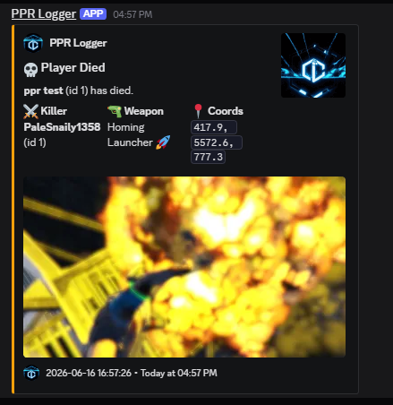

# 🔒 ppr-logger

**Advanced Discord Logger + Ghost Ped Leave System for FiveM**

By **pratheek** · PPR Development

---

## 📸 Previews

| Disconnect Inspection Card (In-Game NUI) | Discord Webhook Logs (Embeds) |
| :---: | :---: |
|  |  |

---

## ✨ Features

| Feature | Description |
|---|---|
| **Webhook Logger** | Queue-based Discord webhook system with rate-limit handling (429 retry) |
| **Ghost Ped** | When a player disconnects, a frozen clone spawns at their last position |
| **Mugshot Pose** | Ghost ped plays a police lineup animation holding a mugshot board |
| **NUI Inspection** | Walk up and press E to open a premium inspection card |
| **Combat-Log Detection** | Flags players who disconnect during combat or while dead |
| **Disconnect Classification** | Distinguishes between quit, timeout, kick/ban, and crash |
| **Framework Support** | Auto-detects ESX, QBCore, or runs standalone — zero config |
| **Privacy Safe** | IP addresses go to Discord only, NEVER to clients |
| **0.00ms Idle** | Two-loop optimization pattern for zero resmon cost |

---

## 📋 Requirements

- **FiveM Server** with **OneSync** enabled (`set onesync on`)
- At least one Discord webhook URL
- Lua 5.4 (enabled in manifest)

---

## 📦 Installation

1. Download / clone into your `resources/` folder
2. Add `ensure ppr-logger` to your `server.cfg`
3. Open `config.lua` and paste your Discord webhook URLs
4. Restart your server

---

## ⚙️ Configuration

All settings are in `config.lua`. You never need to touch the core code.

### Webhooks
```lua
Config.Webhooks = {
    ['joins']     = 'https://discord.com/api/webhooks/...',
    ['leaves']    = 'https://discord.com/api/webhooks/...',
    ['chat']      = 'https://discord.com/api/webhooks/...',
    ['deaths']    = 'https://discord.com/api/webhooks/...',
    ['combatlog'] = 'https://discord.com/api/webhooks/...',
    ['custom']    = 'https://discord.com/api/webhooks/...', -- fallback
}
```

### Ghost Ped
```lua
Config.LeavePed = {
    enabled      = true,
    despawnTime  = 5 * 60 * 1000,  -- 5 minutes
    interactDist = 2.0,            -- meters
    drawDist     = 15.0,           -- meters
}
```

### Combat-Log Detection
```lua
Config.CombatLog = {
    enabled      = true,
    combatWindow = 30 * 1000,  -- 30 seconds
    flagIfDead   = true,
}
```

---

## 🔌 Export API

Other resources can log to Discord:

```lua
exports['ppr-logger']:Log(channel, title, message, color, fields)
```

**Parameters:**
| Param | Type | Description |
|---|---|---|
| `channel` | string | Key from `Config.Webhooks` |
| `title` | string | Embed title |
| `message` | string | Embed description |
| `color` | string/number | Color name or decimal RGB |
| `fields` | table/nil | Optional embed fields |

**Example:**
```lua
exports['ppr-logger']:Log('custom', '🏦 Bank Robbery', 
    'Player X robbed the Fleeca bank', 'orange', {
    { name = 'Amount', value = '$50,000', inline = true },
    { name = 'Location', value = 'Fleeca Bank, Route 68', inline = true },
})
```

---

## 📁 File Structure

```
ppr-logger/
├── fxmanifest.lua          — Resource manifest
├── config.lua              — All settings (shared)
├── server/
│   ├── utils.lua           — Identifier helpers, character name resolver
│   ├── webhook.lua         — Queue, rate limiter, embed builder, Log export
│   ├── leaveped.lua        — Capture data on drop, spawn ped, statebag
│   └── events.lua          — Built-in logs: connect, chat, death
├── client/
│   ├── leaveped.lua        — Ped detection, anim/prop, 3D text, interaction
│   └── death.lua           — Death detection + damage tracking
└── html/
    ├── index.html          — Inspection card markup
    ├── style.css           — Card styling
    └── script.js           — Show/hide card, clipboard copy
```

---

## 🧠 Technical Highlights

| Concept | File | Why It Matters |
|---|---|---|
| Webhook queue + 429 retry | `server/webhook.lua` | Real rate-limit engineering |
| Data capture during `playerDropped` | `server/leaveped.lua` | Zero-cost tracking |
| Server-side `CreatePed` (OneSync) | `server/leaveped.lua` | Modern entity ownership |
| Statebags for entity data | Both `leaveped` files | Event-less, late-joiner safe |
| Framework bridge via `GetResourceState` | `server/utils.lua` | Standalone-first design |
| Two-loop optimization | `client/leaveped.lua` | 0.00ms idle resmon |
| Combat-log detection | `client/death.lua` + `server/leaveped.lua` | Anti-abuse tool |
| NUI clipboard fallback | `html/script.js` | Practical NUI quirk handling |
| XSS sanitization in NUI | `html/script.js` | Security best practice |
| IP privacy separation | Statebag vs embed | IP → Discord only, never clients |

---

## 📜 License

MIT — see [LICENSE](LICENSE)

---

Made with ❤️ by **pratheek** · PPR Development
